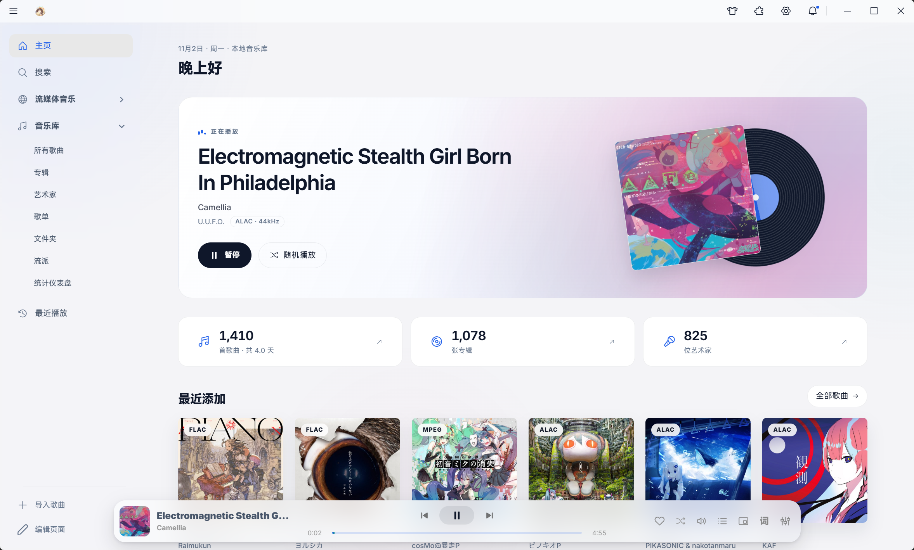
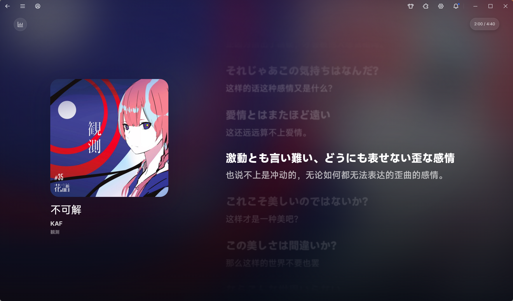
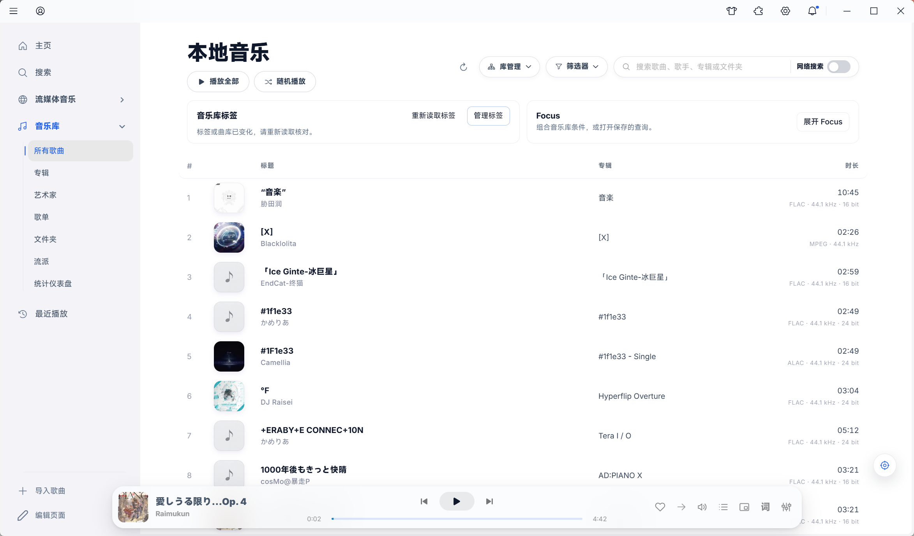
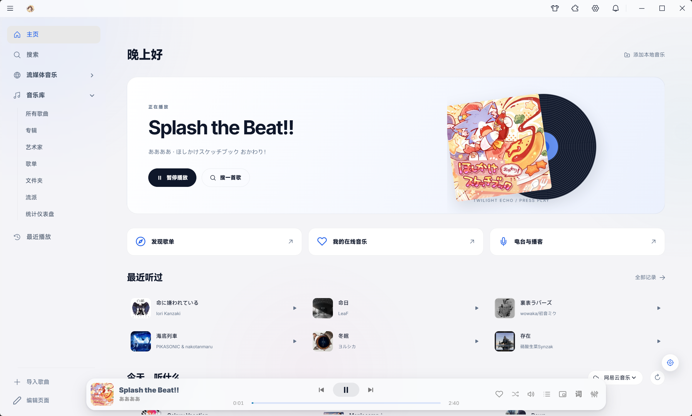
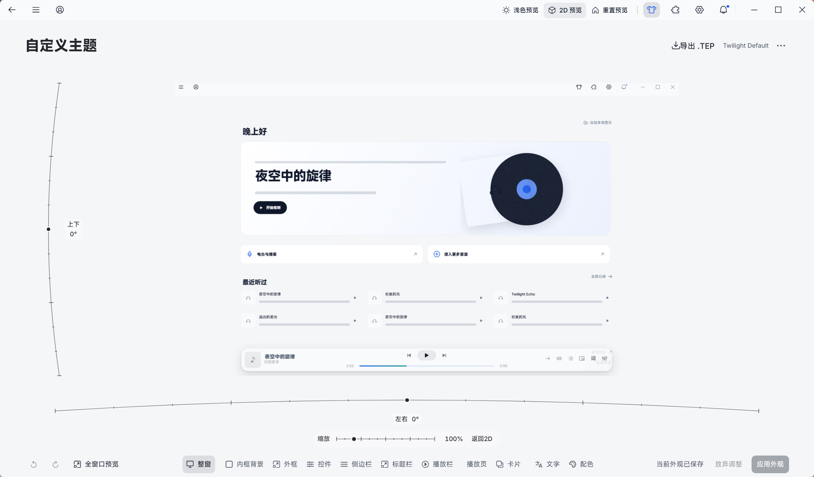
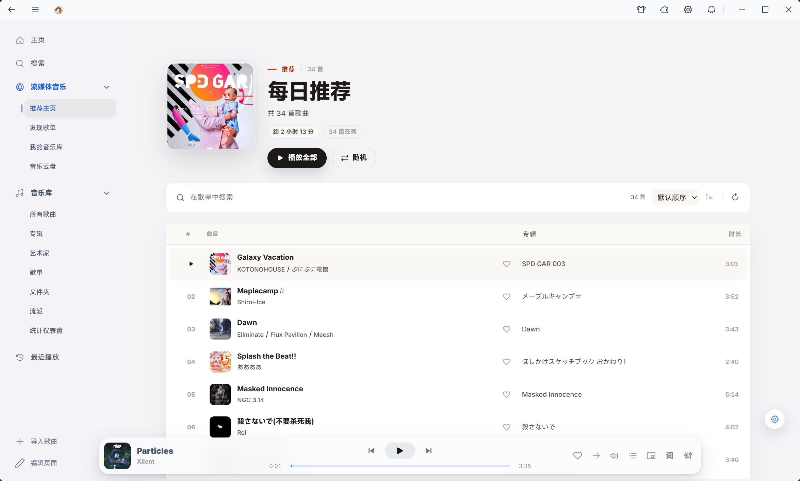
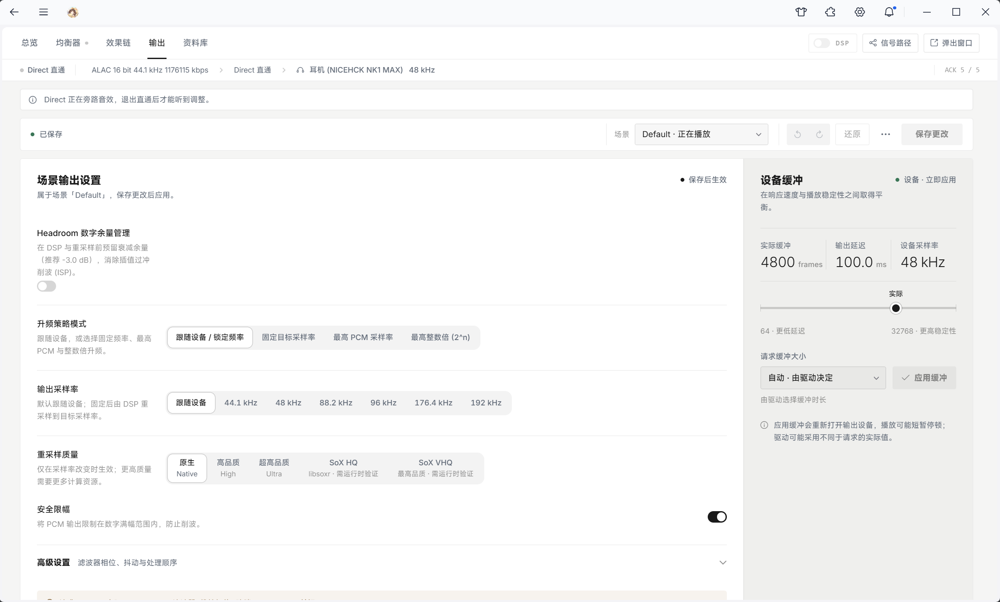

<h1 align="center">Twilight Echo</h1>

  

  <strong>Cherish the music you love, and discover your next favorite track.</strong> 
  An open-source desktop music player uniting large-scale local library management, online music discovery, immersive lyrics, 2D/3D theme customization, and audiophile-grade HiFi tuning.

  
  
  
  

  <a href="./README.md">简体中文</a> · <strong>English</strong>

  <a href="https://github.com/Px-asen/Twilight_Echo/releases/latest"><strong>Download Latest</strong></a>
  · <a href="#interface-preview">Interface Preview</a>
  · <a href="#key-features">Key Features</a>
  · <a href="#quick-start">Quick Start</a>
  · <a href="#faq">FAQ</a>
  · <a href="https://github.com/Px-asen/Twilight_Echo/issues">Feedback</a>

  💬 <strong>Official User Community (QQ Group): <code>1093775290</code></strong> — Share audio tuning tips, join preview testing, and get extra music provider &amp; theme extensions!

From lossless treasures on your hard drive to fresh daily discoveries—let music accompany every moment of your day, your way.

---

## Interface Preview

### Immersive Lyrics & 2D/3D Theme Customization

Dynamic cover-art ambient lighting blends seamlessly with bilingual synchronized lyrics; in the new Custom Theme Studio, inspect and fine-tune every window detail in real time with interactive 2D/3D spatial preview.

<table>
  <tr>
    <td width="50%"></td>
    <td width="50%"></td>
  </tr>
  <tr>
    <td align="center"><strong>All Songs</strong> · Library Tags, Focus Filters & Instant Search</td>
    <td align="center"><strong>Music Dashboard</strong> · Now Playing, Online Discovery & Recently Played</td>
  </tr>
  <tr>
    <td width="50%"></td>
    <td width="50%"></td>
  </tr>
  <tr>
    <td align="center"><strong>Custom Theme Studio</strong> · 2D/3D Spatial Preview & <code>.tep</code> Theme Export</td>
    <td align="center"><strong>Daily Mix Playlist</strong> · In-playlist Search, One-click Play & Discovery</td>
  </tr>
</table>

### Professional Audio Workstation & Extensions

<table>
  <tr>
    <td width="50%"></td>
    <td width="50%"></td>
  </tr>
  <tr>
    <td align="center"><strong>Audio Workstation</strong> · Signal Path, Upsampling Policy, SoX Resampling & Buffer Control</td>
    <td align="center"><strong>Twilight EQ</strong> · 32-Band Parametric EQ, Real-time Spectrum & AutoEQ Profiles</td>
  </tr>
</table>

<strong>View More Screenshots: Streaming Home, Acoustic Visualizer & Extension Center</strong>

 

<table>
  <tr>
    <td width="50%"></td>
    <td width="50%"></td>
  </tr>
  <tr>
    <td align="center"><strong>Streaming Hub</strong> · Daily Mix, Personal Roaming & Curated Playlists</td>
    <td align="center"><strong>Acoustic Visualizer</strong> · Real-time Spectrum, Dynamic Range & Loudness Telemetry</td>
  </tr>
  <tr>
    <td width="50%" colspan="2" align="center"></td>
  </tr>
  <tr>
    <td colspan="2" align="center"><strong>Extension Center</strong> · Manage Music Providers, Themes & Utility Plugins</td>
  </tr>
</table>

---

## Key Features

<table>
  <tr>
    <td width="50%" valign="top">
      <h3>🎵 Effortless Local Library Organization</h3>
      
Real-time multi-folder watching, custom library tags, <strong>Focus multi-condition queries</strong>, and instant browsing across 100,000+ tracks. Complete with rich artist profiles, smart metadata identification, batch tag editing, duplicate cleanup, library health diagnostics, and automatic CUE sheet splitting.

    </td>
    <td width="50%" valign="top">
      <h3>🔎 Unified Online & Network Music Sources</h3>
      
Search across local and online tracks, albums, artists, and playlists in one place. Stream directly from your home NAS via <strong>WebDAV, SMB, SFTP, and FTP</strong>, listen to internet radio stations, subscribe to RSS podcasts, or expand your sources through community plugins.

    </td>
  </tr>
  <tr>
    <td valign="top">
      <h3>✨ Immersive Bilingual Lyrics & Desktop Companion</h3>
      
Line-by-line and word-by-word synchronized lyrics with full TTML support, displaying original lyrics, translations, and romanization in clean layers. Enjoy dynamic cover-art backdrops, full system font customization (CJK & Latin), lyric timing offset controls, standalone desktop lyrics, and Dynamic Island mode.

    </td>
    <td valign="top">
      <h3>🎨 2D/3D Custom Theme Studio</h3>
      
Choose between light and dark modes, dynamic cover palettes, frosted glass, and liquid glass materials. With the interactive <strong>2D/3D Custom Theme Studio</strong>, inspect and fine-tune window frames, backgrounds, controls, sidebars, title bars, player bars, cards, typography, and colors in real time—then export your creation as a shareable <code>.tep</code> package.

    </td>
  </tr>
  <tr>
    <td valign="top">
      <h3>🎧 Audiophile HiFi Engine & DSP Workstation</h3>
      
Native audio engine with WASAPI Shared & Exclusive output, PCM sample-rate conversion (PCM SRC), and DSD playback. ASIO and experimental PCM-to-DSD64/128/256 output still need real-device validation. Equipped with a <strong>32-band Parametric Equalizer (Twilight EQ)</strong>, OPRA / AutoEQ headphone compensation, modular DSP rack, loudness-matched A/B snapshots, and 2000-point waveform analysis.

    </td>
    <td valign="top">
      <h3>🎚️ Twilight AutoMix & Afterglow Mode</h3>
      
Configure gapless playback, crossfading, or <strong>Twilight AutoMix</strong> (with Natural and DJ beat-matching modes, plus optional AI vocal/bass stem separation packs). Activate <strong>Afterglow Mode</strong> to unload the UI renderer and free up RAM while the native audio engine continues playing without interruption.

    </td>
  </tr>
  <tr>
    <td valign="top">
      <h3>📊 Listening Analytics & Versatile Playback</h3>
      
Track your 7 / 30 / 90-day listening trends, activity calendar, and top tracks & artists on the Statistics Dashboard. Save named queues, set audio bookmarks, adjust speed & pitch independently, loop A-B segments, set sleep timers, and control playback across devices on your local network.

    </td>
    <td valign="top">
      <h3>🧩 Open Plugin Ecosystem & Personal Backup</h3>
      
Install music providers, custom themes, and utility extensions (<code>.tep</code>) from the Extension Center. Moving to a new PC? Export a comprehensive personal backup covering playlists, queues, tags, bookmarks, and listening history, with interactive directory mapping upon restore.

    </td>
  </tr>
</table>

---

## Download & Installation

**[Download the Latest Release from GitHub Releases →](https://github.com/Px-asen/Twilight_Echo/releases/latest)**

| Platform | Recommended Package | Installation Notes |
| :--- | :--- | :--- |
| **Windows 10 / 11** | `*-setup.exe` | Run the installer and follow the setup wizard to choose your installation directory. |
| **macOS** | `*-mac-arm64.dmg` (Apple Silicon) `*-mac-x64.dmg` (Intel) | Drag into Applications. On first launch, right-click the app and select **Open**, or run: `xattr -dr com.apple.quarantine /Applications/TwilightEcho.app` |
| **Linux (x64)** | `*.AppImage` / `*.deb` / `*.rpm` / `*.tar.gz` | Make `.AppImage` executable (`chmod +x`) to run directly, or install `.deb` / `.rpm` via your package manager. |

> macOS (CoreAudio) and Linux (ALSA) backends and packages are available, but have not received the same release and real-device validation as Windows.

> [!TIP]
> Every release asset includes a matching `.sha256` checksum file. When you launch Twilight Echo for the first time, the onboarding wizard will guide you through importing your music folders, choosing a theme, and configuring your audio output in under a minute.

---

## Quick Start

1. **Import Your Local Library**: Add your music folders during onboarding or via **Local Music → Import Songs**. Use **Library Tags** and **Focus** at the top of your library view to filter tracks by genre, sample rate, release year, or custom tags.
2. **Explore Online & NAS Music**: Browse recommendations and playlists under **Streaming Music**, install additional provider plugins in the **Extension Center**, or connect your NAS via WebDAV / SMB under **Network Sources**.
3. **Instant Search & Track Locator**: Press **`Ctrl + K`** anywhere to open the Command Palette and jump straight to songs, playlists, pages, or settings. Click the target button at the bottom-right of any track list to scroll directly to the currently playing song.
4. **Customize Themes & Fonts**: Click the **Custom Theme** icon (👕) in the top bar to enter the 2D/3D Theme Studio, customize materials and colors, or pick any installed system font under **Settings → Appearance**.
5. **Dial In Your Sound & AutoMix**: Select your DAC / output device and test left/right channels in **Settings → Playback & Audio**. Enable **Twilight AutoMix** (Natural or DJ mode) for seamless, beat-aware transitions between songs.

---

## Supported Audio Formats

| Category | Formats |
| :--- | :--- |
| **Lossless & PCM** | FLAC, WAV / WAVE, AIFF / AIF, ALAC, APE, WavPack (WV) |
| **DSD & Archival Releases** | DSF, DFF, SACD ISO, with automatic CUE sheet track splitting |
| **Lossy & Containers** | MP3, AAC, M4A, OGG, Opus, WMA, MP4, WebM |

---

## FAQ

<strong>Do I need an internet connection or account if I only listen to local music?</strong>

No. Local library scanning, tag management, Focus filtering, EQ/DSP tuning, and local lyrics all work 100% offline without any account login. An internet connection is only needed for online streaming, online lyric matching, internet radio, and podcasts.

<strong>Where can I find the Statistics Dashboard, Radio, Podcasts, and NAS Network Sources?</strong>

Click **Edit Pages** at the bottom of the left sidebar to pin **Statistics Dashboard**, **Radio / Podcasts**, or **Network Sources** to your sidebar and reorder navigation items—or press **`Ctrl + K`** to jump to any page immediately.

<strong>How do I enable Twilight AutoMix and AI stem separation?</strong>

Go to **Settings → Playback & Audio → Transitions → Twilight AutoMix** and select **Natural** or **DJ** mode.
- **Standard AutoMix**: Works out of the box with no extra downloads required.
- **AI Stem Separation**: For independent vocal and bass stem transitions, download the optional stem runtime pack (`.zip`) from the matching version on [GitHub Releases](https://github.com/Px-asen/Twilight_Echo/releases) and click **Install Stem Pack…** in the AutoMix settings (supports both CPU and GPU acceleration).

<strong>Why can't other apps play sound when WASAPI Exclusive mode is enabled?</strong>

WASAPI Exclusive mode gives Twilight Echo direct hardware access to your audio interface or USB DAC, bypassing the OS mixer for bit-perfect sample rate and bit depth playback. While exclusive playback is active, other applications cannot output audio to that same device. For everyday multitasking, simply switch to **WASAPI Shared** mode.

<strong>How do I migrate my playlists, tags, and listening history to a new computer?</strong>

Go to **Settings → System & About → Backup & Restore** to export a personal data backup archive. On your new computer, select the backup file, preview the items to restore, and map your old music folder paths to their new locations—your playlists, custom tags, queues, lyric edits, bookmarks, and listening stats will be seamlessly restored.

---

## Community & Feedback

Have a question, bug report, or feature request? We'd love to hear from you:

- **GitHub Issues**: [Submit a Bug Report or Feature Request](https://github.com/Px-asen/Twilight_Echo/issues/new/choose). For audio playback issues, you can export a diagnostic report via **Settings → System & About → Export Audio Diagnostics** and attach it to your issue.
- **User Community (QQ Group)**: `1093775290`
- **Developer Contact (QQ)**: `3248974986`

---

## Support & Contributing

If you enjoy using Twilight Echo, please consider giving the repository a **Star ⭐**, sharing it with friends, or supporting ongoing development via **[Afdian](https://afdian.com/a/pxasen)**. All supporters are credited in the in-app contributors list!

Interested in building plugins or contributing code? Check out our documentation:
- [Developer Guide](./docs/DEVELOPER_README.md) · [Plugin Development Guide](./docs/PLUGIN_README.md) · [Plugin Specification](./docs/twilight-echo-plugin-spec.md) · [Community Plugin Repository](https://github.com/Px-asen/Twilight-Echo-plugins) · [Documentation Index](./docs/README.md)

---

## License

Twilight Echo is licensed under the [Apache License 2.0](./LICENSE). For copyright or partnership inquiries, please contact `Pxasen@outlook.com`.

---

## Star History

  <a href="https://star-history.com/#Px-asen/Twilight_Echo&Date">
    <picture>
      <source media="(prefers-color-scheme: dark)" srcset="https://api.star-history.com/svg?repos=Px-asen/Twilight_Echo&type=Date&theme=dark" />
      <source media="(prefers-color-scheme: light)" srcset="https://api.star-history.com/svg?repos=Px-asen/Twilight_Echo&type=Date" />
      
    </picture>
  </a>

