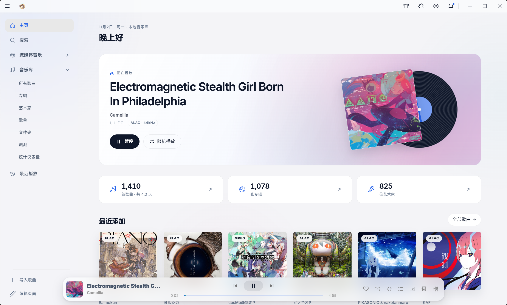
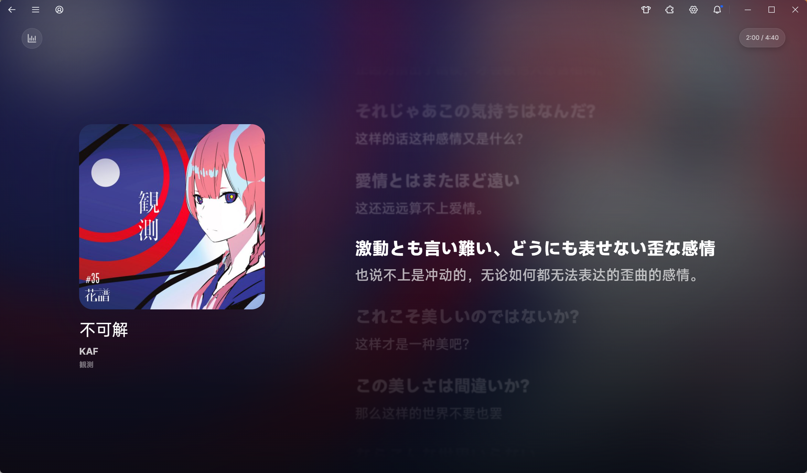
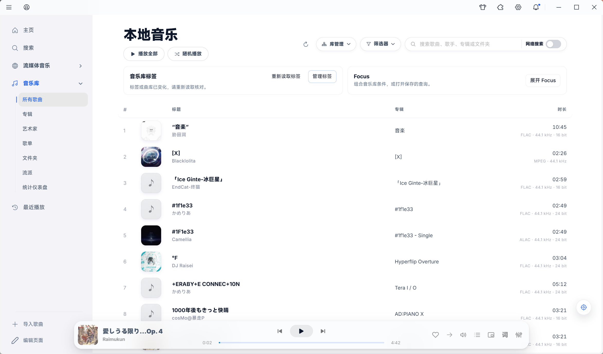
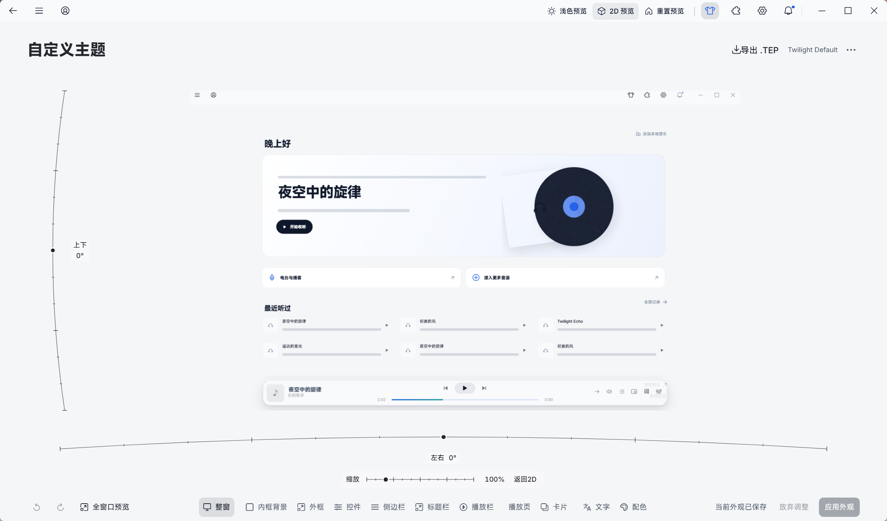
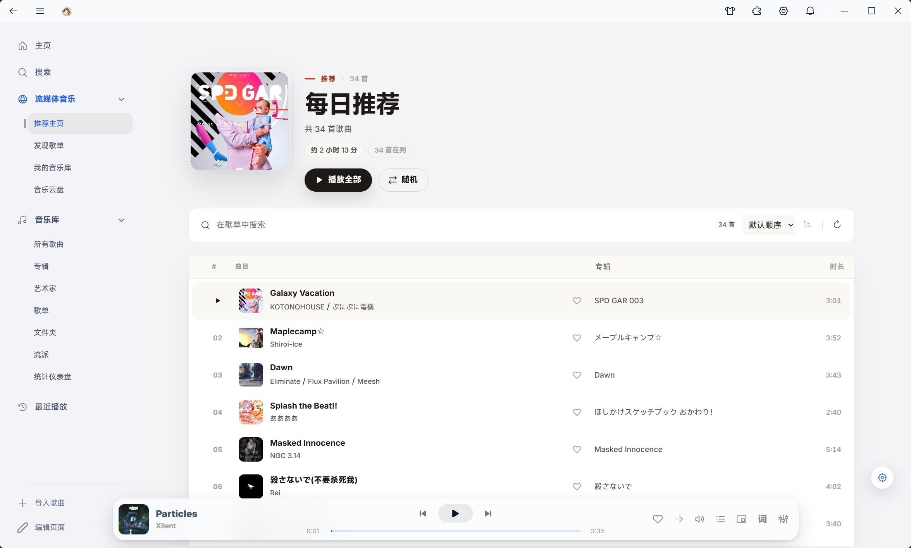
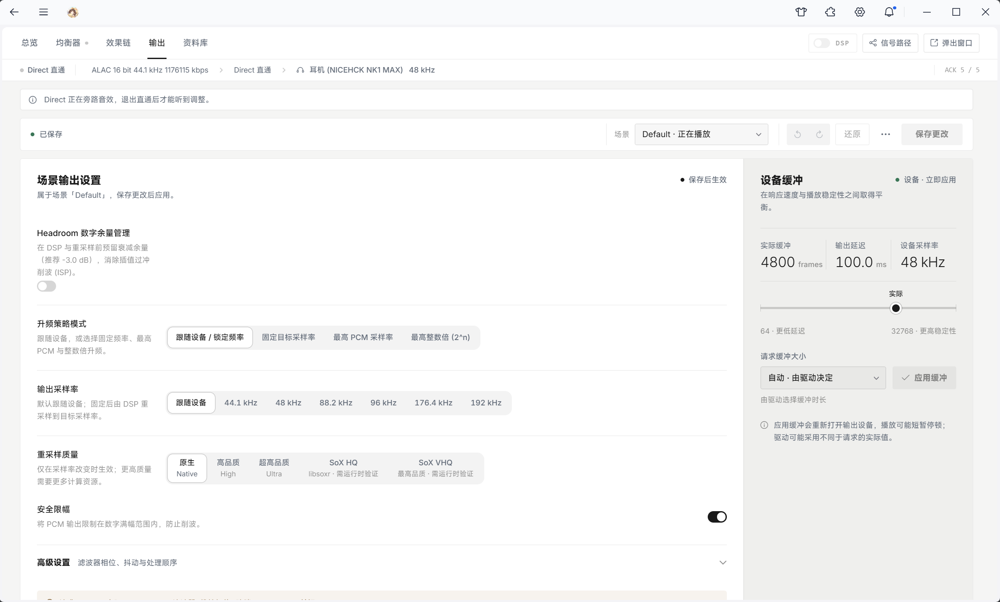

<h1 align="center">Twilight Echo</h1>

  

  <strong>收藏你喜欢的音乐，找到下一首心动。</strong> 
  集本地大曲库管理、在线音乐发现、沉浸式歌词、2D/3D 主题定制与专业 HiFi 调音于一体的开源桌面音乐播放器。

  
  
  
  

  <strong>简体中文</strong> · <a href="./README.en.md">English</a>

  <a href="https://github.com/Px-asen/Twilight_Echo/releases/latest"><strong>立即下载</strong></a>
  · <a href="#界面预览">界面预览</a>
  · <a href="#核心特性">核心特性</a>
  · <a href="#快速上手">快速上手</a>
  · <a href="#常见问题">常见问题</a>
  · <a href="https://github.com/Px-asen/Twilight_Echo/issues">问题反馈</a>

  💬 <strong>官方用户交流 QQ 群：<code>1093775290</code></strong> — 交流使用与调音心得、参与新版本内测、获取 Apple Music 等更多音源与主题扩展！

从硬盘里的无损珍藏，到每日推荐里的新发现，让音乐以你最舒服的方式陪伴每一个日常。

---

## 界面预览

### 沉浸式歌词与定制化主题工作区

封面流光、双语歌词与色彩氛围自然交融；在全新的自定义主题工作区中，可通过 2D/3D 空间视角实时预览并精细调节全窗口每一处细节。

<table>
  <tr>
    <td width="50%"></td>
    <td width="50%"></td>
  </tr>
  <tr>
    <td align="center"><strong>本地所有歌曲</strong> · 音乐库标签管理、Focus 筛选与快速检索</td>
    <td align="center"><strong>综合音乐主页</strong> · 正在播放、在线歌单入口与最近收听</td>
  </tr>
  <tr>
    <td width="50%"></td>
    <td width="50%"></td>
  </tr>
  <tr>
    <td align="center"><strong>自定义主题</strong> · 2D/3D 空间预览、全窗口精调与 <code>.tep</code> 导出</td>
    <td align="center"><strong>每日推荐歌单</strong> · 歌单内搜索、一键播放与在线音乐发现</td>
  </tr>
</table>

### 专业音频工作台与扩展生态

<table>
  <tr>
    <td width="50%"></td>
    <td width="50%"></td>
  </tr>
  <tr>
    <td align="center"><strong>音频工作台</strong> · 信号路径、升频策略、SoX 重采样与设备缓冲控制</td>
    <td align="center"><strong>Twilight EQ</strong> · 32 频段参数均衡、实时频谱与 AutoEQ 耳机校正</td>
  </tr>
</table>

<strong>展开查看更多界面：在线音乐主页、声学频谱仪表盘与扩展中心</strong>

 

<table>
  <tr>
    <td width="50%"></td>
    <td width="50%"></td>
  </tr>
  <tr>
    <td align="center"><strong>在线推荐主页</strong> · 每日推荐、私人漫游与精选歌单</td>
    <td align="center"><strong>声学仪表盘</strong> · 实时频谱、动态范围与响度监测</td>
  </tr>
  <tr>
    <td width="50%" colspan="2" align="center"></td>
  </tr>
  <tr>
    <td colspan="2" align="center"><strong>扩展中心</strong> · 一键管理音源、主题与增强工具插件</td>
  </tr>
</table>

---

## 核心特性

<table>
  <tr>
    <td width="50%" valign="top">
      <h3>🎵 井井有条的本地音乐库</h3>
      
支持多文件夹实时监听、音乐库标签管理、<strong>Focus 多条件组合查询</strong>与十万级大曲库秒级检索。内置艺术家详情页、公共音乐资料智能识别、批量标签编辑、重复曲目清理、曲库健康诊断与 CUE 整轨自动分曲。

    </td>
    <td width="50%" valign="top">
      <h3>🔎 触手可及的在线音乐与网络源</h3>
      
聚合搜索本地与在线歌曲、专辑、歌手及歌单；内置网易云音乐每日推荐、私人漫游、排行榜与音乐云盘。原生支持 <strong>WebDAV、SMB、SFTP、FTP</strong> 等 NAS 网络源，以及网络电台与 RSS 播客订阅。

    </td>
  </tr>
  <tr>
    <td valign="top">
      <h3>✨ 沉浸式双语歌词与桌面陪伴</h3>
      
支持逐行、逐字精准同步与 TTML 格式，原文、翻译、罗马音分层清晰展示。流光背景随专辑封面自然晕染，支持本机中英日文字体自由定制、歌词时间轴微调、独立桌面歌词与灵动岛模式。

    </td>
    <td valign="top">
      <h3>🎨 2D/3D 自定义主题工作区</h3>
      
提供深浅双色、封面动态取色、毛玻璃与液态玻璃材质。在全新的<strong>自定义主题</strong>工作区中，可通过 2D/3D 视角实时预览并精细调节整窗、内框、外框、控件、侧边栏、标题栏、播放栏、卡片、文字与配色，一键导出 <code>.tep</code> 主题包分享。

    </td>
  </tr>
  <tr>
    <td valign="top">
      <h3>🎧 专业 HiFi 音频引擎与调音台</h3>
      
支持 WASAPI 共享与独占输出、ASIO 驱动、高精度重采样与 DSD 播放。内置最高 <strong>32 频段参数均衡器（Twilight EQ）</strong>、OPRA / AutoEQ 耳机频响数据库、模块化 DSP 效果链、等响度 A/B 快照对比与 2000 点高精度分析波形。

    </td>
    <td valign="top">
      <h3>🎚️ Twilight AutoMix 与余晖模式</h3>
      
支持无缝播放、交叉淡化与 <strong>Twilight AutoMix 智能混音</strong>（提供自然过渡与 DJ 对拍模式，可选装人声/贝斯分轨增强包）。独创<strong>余晖模式（Afterglow）</strong>，关闭界面后释放渲染内存，由底层原生引擎零中断继续播放。

    </td>
  </tr>
  <tr>
    <td valign="top">
      <h3>📊 个人听歌统计与全能播放控制</h3>
      
统计仪表盘直观呈现近 7 / 30 / 90 天收听趋势、活动日历及常听歌手与曲目排行。支持命名队列保存、播放书签、变速不变调、A-B 循环、睡眠定时、全局快捷键与局域网多设备遥控。

    </td>
    <td valign="top">
      <h3>🧩 开放插件生态与安心数据备份</h3>
      
通过扩展中心轻松安装和管理第三方音源、主题与工具扩展（<code>.tep</code>）。内置完整的个人数据备份与恢复工具，换机时可一键迁移歌单、队列、标签、书签与收听记录，并自动映射新电脑的音乐目录。

    </td>
  </tr>
</table>

---

## 下载与安装

**[前往 GitHub Releases 下载最新版本 →](https://github.com/Px-asen/Twilight_Echo/releases/latest)**

| 平台 | 推荐安装包 | 安装说明 |
| :--- | :--- | :--- |
| **Windows 10 / 11** | `*-setup.exe` | 下载后直接运行安装向导，选择安装目录即可完成安装与桌面快捷方式创建。 |
| **macOS** | `*-mac-arm64.dmg` (Apple 芯片) `*-mac-x64.dmg` (Intel 芯片) | 拖入 Applications 即可。首次打开如遇系统提示，可右键应用选择「打开」，或在终端运行 `xattr -dr com.apple.quarantine /Applications/TwilightEcho.app`。 |
| **Linux (x64)** | `*.AppImage` / `*.deb` / `*.rpm` / `*.tar.gz` | `.AppImage` 赋予执行权限后可直接运行；Debian/Ubuntu 推荐使用 `.deb`，Fedora/RHEL 推荐使用 `.rpm`。 |

> [!TIP]
> 每个发布版本均附带同名的 `.sha256` 校验文件。首次启动 Twilight Echo 时，跟随引导向导即可在 1 分钟内完成音乐目录导入、外观风格与输出设备配置。

---

## 快速上手

1. **导入本地音乐**：在首次启动向导或「本地音乐 → 导入歌曲」中添加音乐文件夹。扫描完成后，可使用顶部的**音乐库标签**与 **Focus** 筛选器按流派、采样率、年代或自定义标签快速组合筛选。
2. **畅听在线与 NAS 音乐**：打开「流媒体音乐」浏览每日推荐、歌单与排行榜；或前往「扩展中心」安装更多音源插件。拥有家庭 NAS 的用户可在「网络源」中直接挂载 WebDAV / SMB 曲库串流播放。
3. **全局快速检索与定位**：按下 **`Ctrl + K`** 呼出命令面板，一步直达任意歌曲、歌单、页面或设置项；点击列表右下角的定位图标即可瞬间跳转到当前正在播放的曲目。
4. **定制专属外观与字体**：点击顶部工具栏的「自定义主题」图标（👕），在 2D/3D 预览画布中随心调整窗口材质、背景图与各区域配色；在「设置 → 外观」中还可自由切换系统安装的任意中英日文字体。
5. **开启高音质与自动混音**：在「设置 → 播放与音效」中选择音频输出设备（支持左右声道测试音）及 WASAPI 独占模式；在「歌曲衔接 → Twilight AutoMix」中开启自然或 DJ 混音模式，体验电台般丝滑的切歌过渡。

---

## 支持的音频格式

| 类别 | 支持格式 |
| :--- | :--- |
| **无损音频** | FLAC、WAV / WAVE、AIFF / AIF、ALAC、APE、WavPack (WV) |
| **DSD 与高解析收藏** | DSF、DFF、SACD ISO，支持 CUE 整轨自动分曲 |
| **常见有损与流媒体容器** | MP3、AAC、M4A、OGG、Opus、WMA、MP4、WebM |

---

## 常见问题

<strong>只听本地音乐，需要联网或登录账号吗？</strong>

完全不需要。本地曲库扫描、标签管理、Focus 筛选、均衡器调音与离线歌词均可在纯离线环境下流畅使用。仅当你需要使用在线音乐推荐、在线歌词匹配、网络电台或播客时才需要联网。

<strong>在哪里打开统计仪表盘、电台、播客和 NAS 网络源？</strong>

点击侧边栏底部的「编辑页面」，即可将「统计仪表盘」「电台 / 播客」「网络源」固定到左侧导航栏，并支持自由拖拽调整顺序；也可以随时按 **`Ctrl + K`** 直接搜索打开。

<strong>如何使用 Twilight AutoMix 智能混音与人声/贝斯分轨？</strong>

前往「设置 → 播放与音效 → 歌曲衔接 → Twilight AutoMix」，选择「自然模式」或「DJ 模式」即可开启自动混音。
- **基础混音**：开箱即用，无需额外下载附件。
- **AI 分轨混音增强**：如需在切歌过渡时进行人声与伴奏/贝斯独立分轨过渡，可在 [GitHub Releases](https://github.com/Px-asen/Twilight_Echo/releases) 下载对应版本的分轨运行包（ZIP），在 AutoMix 设置页点击「安装分轨包…」导入即可，支持 CPU 与 GPU 加速。

<strong>开启 WASAPI 独占模式后，为什么其他软件没有声音了？</strong>

WASAPI 独占模式会让播放器直接接管声卡或 USB DAC 的硬件通道，绕过系统混音器以实现原汁原味的采样率与位深直通（Bit-Perfect），因此独占播放期间其他应用无法同时发声。若日常需要边听歌边看视频或语音通话，切换回「WASAPI 共享模式」即可。

<strong>更换电脑或重装系统时，如何备份歌单与听歌记录？</strong>

打开「设置 → 系统与关于 → 备份与恢复」，导出个人数据备份包。在新电脑上导入该备份包时，可预览备份内容并将旧路径一键映射到新电脑的音乐文件夹，所有自建歌单、音乐库标签、播放队列、歌词修改、播放书签与收听统计都会完整恢复。

---

## 交流与反馈

遇到问题或有新功能点子？欢迎通过以下方式与我们联系：

- **提交 Issue**：[前往 GitHub Issues](https://github.com/Px-asen/Twilight_Echo/issues/new/choose) 提交 Bug 反馈或功能建议。音频相关问题可在「设置 → 系统与关于 → 导出音频诊断」中一键生成诊断报告并随附上传。
- **官方用户交流 QQ 群**：`1093775290`（交流听歌与调音心得、参与新版本抢先体验、获取更多音源扩展）。
- **开发者共建联系 QQ**：`3248974986`（欢迎对桌面端、音频引擎或插件生态感兴趣的开发者加入内部开发群）。

---

## 支持项目与开源开发

如果 Twilight Echo 成为了你日常陪伴的音乐播放器，欢迎在右上角为项目点亮一颗 **Star ⭐**、分享给身边的音乐同好，或通过 **[爱发电 (Afdian)](https://afdian.com/a/pxasen)** 赞助支持项目的持续维护与演进。所有捐赠支持者都将永久载入软件内的感谢名单中！

想要开发音源/主题插件或参与源码贡献？欢迎查阅完整开发文档：
- [开发者指南](./docs/DEVELOPER_README.md) · [插件开发指南](./docs/PLUGIN_README.md) · [插件技术规范](./docs/twilight-echo-plugin-spec.md) · [官方与社区插件仓库](https://github.com/Px-asen/Twilight-Echo-plugins) · [文档中心](./docs/README.md)

---

## 开源许可

Twilight Echo 基于 [Apache License 2.0](./LICENSE) 许可开源。如有版权或相关合作事宜，请联系：`Pxasen@outlook.com`。

---

## Star 趋势

  <a href="https://star-history.com/#Px-asen/Twilight_Echo&Date">
    <picture>
      <source media="(prefers-color-scheme: dark)" srcset="https://api.star-history.com/svg?repos=Px-asen/Twilight_Echo&type=Date&theme=dark" />
      <source media="(prefers-color-scheme: light)" srcset="https://api.star-history.com/svg?repos=Px-asen/Twilight_Echo&type=Date" />
      
    </picture>
  </a>

